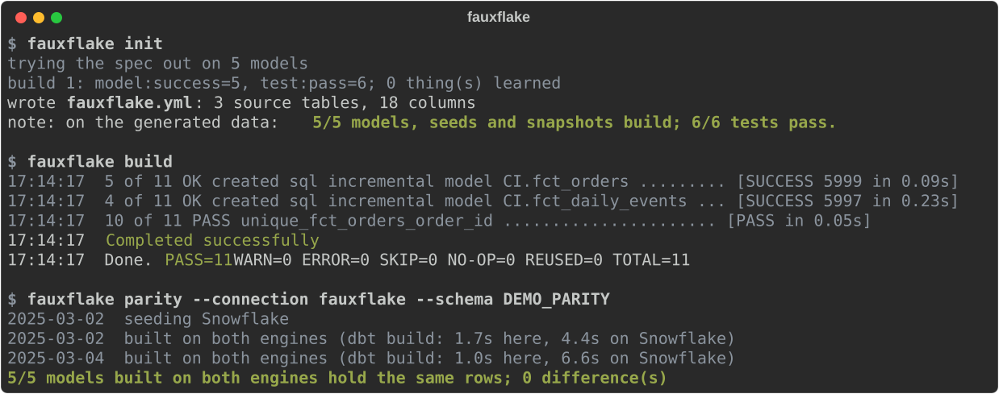
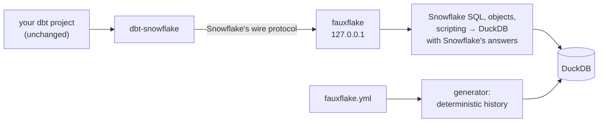

<div align="center">

# fauxflake

**Your dbt-on-Snowflake project, built and tested on your laptop and in CI, with no Snowflake.**

[](https://github.com/mkebiclioglu/fauxflake/actions/workflows/ci.yml)
[](https://github.com/mkebiclioglu/fauxflake/releases)
[](pyproject.toml)
[](LICENSE)



</div>

The project runs unchanged. dbt talks to a Snowflake endpoint on `127.0.0.1` through the real `dbt-snowflake` adapter, and
DuckDB does the work underneath, giving Snowflake's answers. The source tables are generated from a small spec that
`fauxflake init` writes by reading your SQL. CI needs no credentials, no production rows leave the warehouse, and
nothing costs credits.

- **Zero config.** `init` reads the project, generates sources that fit it, and keeps running it until it builds. On
  public projects of 46 to 3,000 models that took no hand edits.
- **Snowflake's answers, measured.** 1,236 queries recorded on Snowflake replay in CI. 2,037 of 2,070 package models
  match Snowflake row for row, and dbt-snowflake's own test suite passes.
- **More than a build.** See what a change does to the rows (`diff`), why a model is empty (`why`), whether an
  incremental model drifts over two weeks (`simulate`), and what a late or duplicated load does (`scenarios`).

## Quick start

```sh
uv tool install git+https://github.com/mkebiclioglu/fauxflake    # or: pipx install git+https://...
cd your-dbt-project
fauxflake init
```

`init` needs no Snowflake access. It prints what it read and learned, then writes `fauxflake.yml`:

```console
$ fauxflake init
trying the spec out on 42 models
  pass 1: 42/42 models run (0 fail on their own), 1 thing(s) learned (12s for 42 model(s))
  build 1: model:success=42, seed:success=4, test:fail=21, test:pass=140; 0 thing(s) learned
wrote fauxflake.yml: 13 source tables, 374 columns
  note: RAW.SLACK.MESSAGES.TEXT: models read a value of RAW.SLACK.USERS.ID out of it, between `(<@` and `>)`; generated with one there.
  note: learned 1 thing(s) by running the project, for example: RAW.SLACK.USERS.UPDATED: used as EPOCH, retyped.
  note: on the generated data: 46/46 models, seeds and snapshots build; 140/161 tests pass.
  note: FAILS assert_event_blend_event_counts: Got 18 results, configured to fail if != 0
next: fauxflake build
```

<sub>That is [Meltano's own dbt project](https://gitlab.com/meltano/squared), from nothing but its code. Tests that
state facts about production data fail on invented data. They are reported, never hidden; `init --fit-tests` fits the
data to them, or the spec states it (see [The spec](#the-spec)).</sub>

From then on:

```sh
fauxflake build                  # dbt build, offline: any selector works (-s my_model+)
fauxflake dev                    # rebuild on save, show what changed against your last commit
fauxflake diff --base origin/main
```

## How it works



- **The endpoint** speaks the protocol the Snowflake connector uses, so dbt, Snowpark and any client connect as they
  would to an account.
- **The translation** rewrites each statement into DuckDB and corrects every place where DuckDB's answer differs from
  Snowflake's: number scale and rounding, NULL ordering, implicit conversions, `VARIANT` semantics, time zones. Each
  correction is pinned by a query whose answer was recorded on real Snowflake. Statements about objects (functions,
  procedures, streams, tasks, policies, stages, tags) are carried out by the emulator itself.
- **The generator** makes the whole history a deterministic function of `(seed, table, column, row number)`. The
  warehouse at simulated time `T` holds the rows with `_loaded_at <= T`, so moving the clock forward brings late,
  duplicated and out-of-order data the way a real loader does.

## Proven on real projects

`init` was pointed at public dbt projects written for Snowflake alone: hooks that create functions and procedures,
models that inspect the warehouse while compiling, sources never declared column by column. No configuration and no
access to their data:

| project | models | sources `init` generated | models, seeds and snapshots that build | tests that pass |
| --- | ---: | --- | --- | --- |
| [Meltano squared](https://gitlab.com/meltano/squared) | 46 | 13 tables, 374 columns | 46/46 | 140/161 |
| [dbt-snowflake-monitoring](https://github.com/get-select/dbt-snowflake-monitoring) (its integration project) | 28 | 13 tables, 214 columns | 28/28 | 3/5 |
| [Mattermost](https://github.com/mattermost/mattermost-data-warehouse), legacy `snowflake-dbt` | 249 | 646 tables, 3,342 columns | 249/249 | 17/18 |
| [Mattermost](https://github.com/mattermost/mattermost-data-warehouse), `mattermost-analytics` | 274 | 563 tables, 7,994 columns | 274/274 | 449/460 |
| [GitLab analytics](https://gitlab.com/gitlab-data/analytics) | 2,912 | 1,095 tables, 18,482 columns | 2,545/3,046, see below | 3,380/5,036 |
| [Flipside NEAR](https://github.com/FlipsideCrypto/near-models-archive) | 64 | 7 tables, 38 columns | 17 or 18 of 64, see below | 52 or 53 of 469 |

<sub>Measured on 0.5.0 from an empty spec, `fauxflake init` and nothing else. Failing tests state facts about
production data (row counts, values that must appear, freshness) and are listed by `init`;
`--fit-tests` fits the data to them. Flipside's models nest each model's query tag inside the next one's; past 2,000
characters Snowflake refuses the tag, and so does the emulator. Which model reaches that first depends on the order
threads run them; the rest are its dependants. GitLab's project is the size of a large company's warehouse: its spec
was made by `init` and then `fauxflake fit` (about an hour per build round on a 64 GB machine), and these are its
numbers after the second build round, with each round still building more.</sub>

`fauxflake parity` then built each project on the emulator and on a real Snowflake account from the same generated
rows and compared every model:

| project | models compared | identical | undetermined (ties, on Snowflake too) | differences |
| --- | ---: | ---: | ---: | ---: |
| [GitLab analytics](https://gitlab.com/gitlab-data/analytics) | 1,980 | 1,953 | 26 | 1, the comparison's own memory limit on a 1,332-column table; compared alone: identical |
| [The Tuva Project](https://github.com/tuva-health/tuva) | 535 | 512 | 23 | 0 |
| Mattermost, `mattermost-analytics` | 266 | 242 | 24 | 0 |
| [datavault4dbt demo](https://github.com/ScalefreeCOM/datavault4dbt-snowflake-demo) | 45 | 45 | 0 | 0 |
| Meltano squared | 42 | 42 | 0 | 0 |
| [dbt-snowflake-evaluator](https://github.com/infinitelambda/dbt-snowflake-evaluator) | 35 | 34 | 1 | 0 |
| dbt-snowflake-monitoring | 27 | 22 | 5 | 0 |
| Flipside NEAR | 16 | 16 | 0 | 0 |

<sub>Measured 2026-11-22 with `fauxflake parity`; Meltano again on 0.5.0 (2026-11-27, 42/42). A model is
undetermined when its rows depend on how tied rows are ordered (`ROW_NUMBER()`, `LAG`, `ARRAY_AGG` without
`WITHIN GROUP`): Snowflake itself gives other rows from one run to the next.</sub>

## It gives Snowflake's answers

| measured | result |
| --- | --- |
| 1,236 queries whose answers were recorded on real Snowflake | 1,235 match; 1 is a known gap (`HLL_ACCUMULATE`'s bytes come from Snowflake's unpublished hash) |
| 36 third-party packages (2,070 models) built here and on Snowflake, compared row for row | 2,037 identical; the other 33 differ where Snowflake's own answer is not fixed: the clock, an order it leaves undefined, `HASH` values, float rounding |
| dbt-snowflake's own functional test suite, run against the emulator | 343 of the 347 tests that pass on Snowflake pass; the other 4 test refusals the emulator does not make (an unknown role or warehouse, a key-pair login) |
| dbt-utils, dbt-expectations, dbt-date, dbt_artifacts, Snowplow and The Tuva Project run against their own test suites | all 2,098 models and tests pass |

**It runs where you are.** A build takes about as long as on an X-Small warehouse (Meltano's 46 models: 27 s here,
29 to 35 s on Snowflake, measured by `fauxflake parity`) and costs nothing: no warehouse and no credentials.
It runs on an 8 GB laptop; generating 281 million rows takes 102 seconds there.

Details and the commands to reproduce each line are under [Evidence](#evidence).

## What you do with it

| when | command |
| --- | --- |
| Starting out | `fauxflake init` writes the spec and fits it until the project builds |
| While editing a model | `fauxflake dev` rebuilds on save and shows what changed against your last commit |
| Before pushing | `fauxflake build` (any dbt selector works: `fauxflake build -s my_model+`) |
| A model came out wrong | `fauxflake build --keep`, then `fauxflake query "select ..."` or `fauxflake query --model my_model` |
| A model came out empty | `fauxflake why my_model` names the join or filter where its rows stop (`--all` for every such model) |
| One model or one test again | `fauxflake dbt test -s my_model` runs any dbt command on the kept warehouse |
| Reviewing a pull request | `fauxflake diff --base origin/main` shows which rows a change alters |
| Incremental models and snapshots | `fauxflake simulate --days 14` lets time pass, then compares with a full refresh |
| Bad days | `fauxflake scenarios` replays late data, duplicates, nulls, spikes and outages |
| The project grew | `fauxflake fit` adds new sources and columns to the spec and keeps your edits |
| Matching production's shape | `fauxflake profile` measures volumes and distributions, aggregates only |
| Switching engines or upgrading | `fauxflake parity --connection <name>` builds on both engines and compares every model |

### dev: while you type

```
$ fauxflake dev
generated 1,872,531 source rows
ok     everything  (1.1s)
watching for changes (Ctrl-C to stop)
ok     stg_orders.sql  (0.5s)
       fct_orders: 3,715 of 79,967 rows differ from HEAD  [NET_AMOUNT 3,715]
       stg_orders: 3,715 of 79,967 rows differ from HEAD
```

Save a file and the edited models and their children are rebuilt, followed by how the output
now differs from your last commit.

### build and query: look at what happened

```sh
fauxflake build --keep                       # keeps the warehouse in .fauxflake/warehouse
fauxflake query "select status, count(*) from fct_orders group by 1"
fauxflake query --model fct_orders --limit 5 # the model's compiled SQL, as the build ran it
fauxflake query -f scratch.sql
fauxflake dbt run -s fct_orders+             # any dbt command, on the same kept warehouse
```

`query` speaks Snowflake SQL, and its clock stands where the build left it, so
`current_date` means what it meant to the models. The functions the project created during the
build are there too, so views that call them can be read.

### why: a model with no rows

A model that builds empty passes every test on it and proves only that its SQL binds. After `fauxflake build --keep`:

```console
$ fauxflake why silver_social__decoded_actions silver__nft_mints_s3
silver_social__decoded_actions: no rows; rows stop in all_social_receipts: where
  _partition_by_block_number >= 75000000
  reads ANALYTICS.silver_social.receipts: 2520 row(s)
  _partition_by_block_number holds: 9820466, 9820555, 9820569, 9820847, 9821144
silver__nft_mints_s3: no rows; rows stop in mint_transactions: where
  tx_status = 'Success'
  reads ANALYTICS.silver.streamline_transactions_final: 3017 row(s)
  tx_status holds: 'Fail'
```

It walks the model's CTEs on the kept warehouse, finds the first one that is empty although what it reads is not, and in it
the join, `WHERE` condition, `FLATTEN`, `QUALIFY` or `HAVING` that keeps nothing, with a sample of what each column involved
holds. `fauxflake why --all` does this for every model where rows stop (models that are empty only because one before them
is are left out).

`init` asks the same question itself once the project builds: where an empty model's join meets made-up text on one side
and real values on the other (the quarters your own calendar model names), or a filter asks for values by name, the
generated source gets those values and the models that read it are built again.

A `unique` test that fails has the mirror question, and `fauxflake why my_model --unique order_id` answers it: the join
after which a row meets several on the other side (with the values that side holds more than once), the UNION whose
sides share keys, or the relation that already held the key twice.

### diff: what did my change do?

```sh
fauxflake diff --base origin/main
```

The base branch and your working tree are built on the same generated rows, so every
difference in the output comes from the code change:

| model | rows | changed rows | columns |
| --- | --- | --- | --- |
| `fct_orders` | 79,967 | 3,715 (4.6%) | `NET_AMOUNT` 3,715 |
| `stg_orders` | 79,967 | 3,715 (4.6%) |  |

The output is Markdown, ready to post on the pull request.

### parity: the same project on the emulator and on Snowflake

```
$ fauxflake parity --connection prod_readonly_ci --schema ANALYTICS_CI
...
DIFF rows          fct_subscriptions
     emulator=1366 snowflake=1366 only_emulator=12 only_snowflake=12 differ in QUANTITY: emulator '12' snowflake '12.00000'
DIFF undetermined  int_active_days
     the order of rows is not determined: 71 tied group(s) in MAX(is_active) OVER (PARTITION BY user_id ORDER BY day ROWS BETWEEN 6 PRECEDING AND CURRENT ROW)

233/259 models built on both engines hold the same rows; 1 difference(s); 9 model(s) whose rows the data does not determine
```

The generated sources are loaded into a schema of your Snowflake account, the project is built on
both engines (every node, also after one fails), and every model is compared row for row. Each
difference names the columns that differ, with a value from each side. Columns that only hold
when the build ran (`current_timestamp()`) are compared as the clock. A model whose result
depends on the order of rows that tie (`ROW_NUMBER()`, `LAG`, a `ROWS` frame, `ARRAY_AGG` without
`WITHIN GROUP`) gives other rows on any engine, Snowflake included; it is reported as
`undetermined`, with the window, rather than as a difference. `--select` narrows the run;
`--report diff.json` keeps every difference. It costs credits: run it when you change engines
or upgrade, not on every pull request.

### simulate: let time pass

```
$ fauxflake simulate --days 14
2025-03-02 00:00  loaded    1,872,531 rows  (0.2s)
2025-03-03 00:00  +     38,016 rows  (generate 0.1s, dbt 0.7s)
...
ok    fct_orders          incremental=98,682 rebuilt=98,682 only_incremental=0 only_rebuilt=0
DRIFT fct_daily_events    incremental=296 rebuilt=296 only_incremental=60 only_rebuilt=60
```

Each day brings that day's rows plus the late tail of earlier days. After the last run every
incremental model is compared with a full refresh and every snapshot is checked for one
current row per key. Tasks that are resumed and have a schedule run at every step. Every dbt
test can pass while an incremental model is wrong; this is the check that finds it.

### scenarios: bad days

```
$ fauxflake scenarios
scenario          verdict          detail
late-spike        SILENT DRIFT     wrong data, no test failed: fct_daily_events
duplicate-storm   survived         builds passed, incrementals match a full refresh
null-surge        caught           dbt build failed on 6 of 7 days; drift in fct_daily_events
volume-spike      survived         builds passed, incrementals match a full refresh
empty-day         survived         builds passed, incrementals match a full refresh
loader-outage     survived         builds passed, incrementals match a full refresh
new-column        survived         builds passed, incrementals match a full refresh
```

**Survived**, **caught** (a test failed, someone would have been paged) or **silent drift**
(every test passed and the data is wrong; exit code 1).

### init: from a dbt project to a build that passes

`init` needs no Snowflake access. It reads what the project already says, then tries it out. Reading the SQL gives each source's columns and the shape of their values; then it runs the project
and learns from what fails. Tests on marts are traced back through staging to the raw column. Sources in the `SNOWFLAKE`
database (`ACCOUNT_USAGE`, `ORGANIZATION_USAGE`) get their real columns.

<details>
<summary>What the SQL tells <code>init</code> about the data</summary>

| the SQL says | so the data has |
| --- | --- |
| `user:login::string` | a JSON column with a `login` field |
| `to_date(x, 'YYYY/MM/DD')` | text dates in that format |
| `to_timestamp(v:created::string)` and `v:created::int` | an epoch number |
| `where state = 'open'` | `open` among the values |
| `where block_id between 9820000 and 10000000` | numbers in that range |
| `where name like 'tap-%'`, `like any ('tap-%', 'target-%')` | names that fit the patterns |
| `rlike(uri, '^/[1-9]+[.][0-9]+/.*')`, `regexp_substr(status, 'Success')` | text the expression matches |
| `split(filename, '/')[0]::number` | text whose first part is a number |
| `split_part(request, ' ', 1) = 'POST'` | text whose first piece is `POST` |
| `try_parse_json(replace(log, 'EVENT_JSON:')):event` | that mark, then JSON with an `event` key |
| `iff(v:status:Failure is not null, 'Fail', 'Success')` | a `Failure` key in few of the documents |
| `where not is_deleted`, `iff(active, 1, 0)` | a boolean |
| `parse_ip(network, 'INET')` | IP ranges |
| `a.account_id = b.id`, `a.account_id in (select id from b)` | `account_id` drawn from `b`'s keys, so the join matches |
| `where server_id = '93my...'` on a column that refers to another table | a row with that id in the table it refers to |
| `on q.warehouse_id = m.entity_id and q.hour = m.start_time` | a meter: one row an hour for each of a few entities |
| `on i.created_at between r.window_start and r.release_date` | periods that follow one another, so a row falls in one |
| `group by license_id having count(distinct seats) = 1` | one number of seats per license |
| `sum(x)`, `x * 2`, `x > 100` | a number |
| columns lined up by a `UNION` | one type |
| a `unique`, `relationships` or `accepted_values` test | a key, a reference, those values |
| `unique_combination_of_columns`, `expression_is_true: "ended_at > started_at"` | the combination once; the two times in that order |
| a seed joined on two columns | the pairs the seed lists |

</details>

<details>
<summary>What running the project teaches it</summary>

| the run says | so the spec gets |
| --- | --- |
| a model reads a column of a source that was only ever `select *`-ed | that column |
| `Could not convert string 'amount_3fa2' to DOUBLE` | `amount` as a number |
| `dbt_utils.union_relations` finds no columns in the event tables | the columns the next model reads |
| a model reads its own table, or a sibling's, by a hard-coded name | an empty table of that shape to start from, as production has |
| a model reads a table nobody declared | a generated source |
| a model that keeps a row a day for every group runs out of memory | a handful of groups |
| the project creates a function in a hook | nothing: the function is used as written |

Tests that fail on the generated data are reported, not fitted: whether a key repeats or a status is allowed is a fact
about your data, and the spec is where you state it. `init --fit-tests` (and `fit --fit-tests`) also learns from them:

| the test says | so the spec gets |
| --- | --- |
| a `unique` test fails | a column without repeats |
| a test returns rows from `group by day, kind having count(*) > 1` | one row a day for each kind |
| a test returns rows from `group by subscription_id having count(*) > 2` | at most two rows per subscription |
| a test returns rows from `where started_at > ended_at` | the end after the start |
| a test about production data still fails | an entry under `dbt.expected_failures` |

</details>

It prints what it learned and what still fails, with the error. `fauxflake fit` repeats this
on an existing spec whenever the project changes.

### In CI

```yaml
- uses: actions/checkout@v7
  with: {fetch-depth: 0}
- uses: mkebiclioglu/fauxflake@v0.5.0
  with: {command: build}
- uses: mkebiclioglu/fauxflake@v0.5.0
  with: {command: simulate, args: --days 14}
```

[`docs/workflows/dbt-ci.yml`](docs/workflows/dbt-ci.yml) is a complete pull request workflow: spec check, build,
simulation, scenarios and the data diff as a comment.
[`docs/workflows/refresh-profile.yml`](docs/workflows/refresh-profile.yml) re-measures production weekly and opens a
pull request with what moved.

## What Snowflake it speaks

| | locally |
| --- | --- |
| **SQL** | Snowflake's dialect and its answers: number scale and rounding, NULL ordering, implicit conversions, time zones, `QUALIFY`, `PIVOT`, `LATERAL FLATTEN`, `ASOF JOIN`, `CONNECT BY`, lateral column aliases, `GENERATOR`, `RESULT_SCAN`; unnamed columns are named as Snowflake names them (`COUNT(*)`, `A+1`) |
| **Semi-structured data** | `VARIANT`, `OBJECT`, `ARRAY` and `MAP` with path access, `FLATTEN`, and the object, array and map functions |
| **Vectors and geospatial** | `VECTOR(FLOAT, n)` and `VECTOR(INT, n)` with the `VECTOR_*` distance and aggregate functions; `GEOGRAPHY` and `GEOMETRY` from WKT, EWKT, GeoJSON and WKB with Snowflake's spherical (S2) and planar measures, predicates and constructors; the `H3_*` functions (`pip install "fauxflake[geo]"`) |
| **Types as Snowflake describes them** | the `VARCHAR(n)` a `CREATE ... AS SELECT` or a view derives (`'initial'` is `VARCHAR(7)`, `a \|\| b` adds the lengths), collations kept through queries and shown by `DESCRIBE`, `SHOW COLUMNS` and `GET_DDL`, `ALTER COLUMN ... SET DATA TYPE` allowed and refused as Snowflake does |
| **dbt** | tables, views, incremental models (`merge`, `delete+insert`, `append`), snapshots, seeds, ephemeral models, tests, hooks, packages, `persist_docs`, `grants`, dynamic tables, secure and materialized views |
| **Python models** | Snowpark sends its SQL here, so a Python model runs like a SQL one (`pip install "fauxflake[snowpark]"`); models that only use `session.sql`, `session.table` and pandas need no extra |
| **Functions** | SQL functions and SQL table functions become macros; Python functions run as written; JavaScript functions run in an embedded engine |
| **Procedures** | Snowflake Scripting (variables, `IF`, `CASE`, loops, cursors, `RESULTSET`, `EXECUTE IMMEDIATE`, exception handlers), JavaScript with the `snowflake` API, Python with a session; `CALL`, anonymous blocks and anonymous procedures |
| **Streams** | show the rows inserted and deleted since they were last consumed; a DML statement that reads one consumes it |
| **Tasks** | stored with their schedule and predecessors; `EXECUTE TASK` runs one and its resumed children; `simulate` runs the scheduled ones at every step |
| **Masking and row access policies** | applied wherever the table is read, for the current role (`USE ROLE`, or `dbt: {role: ...}` in the spec) |
| **Loading** | `COPY INTO` from S3, GCS, Azure or HTTPS with `PATTERN` and `FILES`; internal stages and file formats; external table definitions; pipes and alerts, stored and run on demand |
| **Other statements that change things** | sequences, `CLONE` of tables and schemas, `SWAP WITH`, `MERGE`, `INSERT OVERWRITE` |
| **System views and functions** | `INFORMATION_SCHEMA`; `ACCOUNT_USAGE` and `ORGANIZATION_USAGE` as generated sources with their real columns; table functions such as `TASK_HISTORY()` with the right columns and no rows |
| **Transactions** | `BEGIN`, `COMMIT`, `ROLLBACK`: DML and `MERGE` roll back, DDL commits the open transaction, and a statement that fails leaves it open |
| **Tags** | `CREATE TAG` with allowed values, `SET TAG` and `UNSET TAG` on objects and columns, `SHOW TAGS`, `TAG_REFERENCES`, `TAG_REFERENCES_ALL_COLUMNS` and `SYSTEM$GET_TAG`, with inheritance from schema and database |
| **The account** | `CREATE`, `ALTER` and `DROP` of warehouses, resource monitors, network policies and roles; a `GRANT` to a role the account lacks fails once its roles are described (`init` lists the ones the project grants to); `ALTER ACCOUNT SET`; `SHOW PARAMETERS` at every scope with Snowflake's defaults; every account-level `SHOW` with the columns a real account returns, listing what the spec's `account:` names and what the project created |
| **Constraints** | `PRIMARY KEY`, `UNIQUE` and `FOREIGN KEY`, inline or added by `ALTER TABLE`, with `RELY`/`NORELY`, kept and never enforced (as on Snowflake: only `NOT NULL` is); `MODIFY`/`RENAME`/`DROP CONSTRAINT`; `SHOW PRIMARY`/`UNIQUE`/`IMPORTED`/`EXPORTED KEYS`; `INFORMATION_SCHEMA.TABLE_CONSTRAINTS`, `REFERENTIAL_CONSTRAINTS` and `TABLE_PRIVILEGES`; Snowflake's errors for each, as measured. Held for the run: a kept warehouse opened again has none |
| **Tables and their metadata** | `SHOW TABLES / OBJECTS / VIEWS` with Snowflake's columns, `INFORMATION_SCHEMA.TABLES` with exact row counts, `GET_DDL`, comments, `CLONE`, `COPY GRANTS`, grants kept and shown (`SHOW GRANTS`, `TABLE_PRIVILEGES`); dynamic tables refreshed on create, on `ALTER ... REFRESH` and when their lag has passed |
| **Sessions** | the parameters a client logs in with and `ALTER SESSION SET` / `UNSET` are kept and shown by `SHOW PARAMETERS`; `USE WAREHOUSE` |
| **Staged files** | `SELECT $1, METADATA$FILENAME FROM @stage/path (FILE_FORMAT => ..., PATTERN => ...)`, as Snowpark's `session.read` uses it |
| **Accepted, with nothing to act on** | clustering keys, warehouse sizes |

When the emulator does not know a statement it fails at once with a message that starts with
`fauxflake emulator:`. It does not hang and it does not pass silently.

## Evidence

Everything here was run; the commands are in this repo.

**1. Answers recorded from Snowflake.** [`conformance/cases.yml`](conformance/cases.yml) holds
1,236 small queries, among them one call of each signature of Snowflake's built-in functions,
recorded in UTC; 1 is marked as a known gap (the registers of an `HLL_ACCUMULATE` state, which come from Snowflake's own hash). `fauxflake conformance --connection <name>` runs them on real Snowflake
and stores the answers; CI replays them against the emulator with no Snowflake access. A case
that stops matching fails CI.

**2. Packages built twice.** 36 packages that ship seed data (Fivetran's, Snowplow's, dbt-audit-helper and
dbt-codegen) were built on the emulator and on a real account, and every model compared row for row
(`scripts/selftest.py <project> --snowflake <connection>`, re-run on 2026-11-26). 2,037 of 2,070 models are
identical; each of the other 33 differs where Snowflake's own answer is not fixed, or fails on Snowflake too:

<details>
<summary>The 36 packages</summary>

| package | models | identical | where the rest differ |
| --- | --- | --- | --- |
| Ad Reporting | 331 | 329 | `LISTAGG` without `ORDER BY` |
| Shopify | 211 | 206 | `LISTAGG` order (4), float rounding of a summed id (1) |
| HubSpot | 167 | 167 | |
| QuickBooks | 96 | 95 | a running balance over rows whose order ties |
| NetSuite | 93 | 93 | |
| Greenhouse | 84 | 84 | |
| Zendesk | 76 | 73 | durations measured up to now |
| Pendo | 68 | 68 | |
| Stripe | 63 | 63 | |
| Lever | 53 | 53 | |
| Zuora | 53 | 53 | |
| Snowplow unified | 51 | 50 | one staging model of JSON context documents (built with the package's own test variables) |
| Iterable | 49 | 49 | |
| Recurly | 49 | 49 | |
| Jira | 48 | 41 | `LISTAGG` order (4), durations measured up to now (3) |
| Xero | 43 | 41 | float rounding (1), a pivot whose column order ties (1) |
| Intercom | 42 | 42 | |
| Recharge | 40 | 40 | |
| Marketo | 40 | 40 | |
| Qualtrics | 40 | 40 | |
| Google Ads | 39 | 39 | |
| GitHub | 37 | 31 | durations measured up to now |
| Mailchimp | 33 | 33 | |
| dbt-audit-helper | 30 | 25 | `HASH` values (1), the clock (2), models whose unit tests fail on Snowflake too (2) |
| Asana | 28 | 28 | |
| Workday | 27 | 27 | |
| LinkedIn Ads | 25 | 25 | |
| Facebook Ads | 24 | 24 | |
| Salesforce | 24 | 24 | |
| Sage Intacct | 23 | 23 | |
| Fivetran Platform | 22 | 22 | |
| Twilio | 20 | 20 | |
| Klaviyo | 18 | 18 | |
| Amplitude | 8 | 7 | the clock |
| dbt-codegen | 8 | 8 | |
| Mixpanel | 7 | 7 | |

</details>

**3. Packages that test themselves.** dbt-utils (237), dbt-expectations (169), dbt-date (73),
dbt_artifacts (136), Snowplow (234) and The Tuva Project's integration project (1,249: its seeds
load from S3 with `COPY INTO`) pass in full here.

## The spec

[`example/fauxflake.yml`](example/fauxflake.yml) is a complete one. What `init` writes is a
starting point that builds; `fauxflake profile` replaces its placeholder volumes and
distributions with measurements from production, reading aggregates only.

<details>
<summary>Every key of the spec</summary>

| key | meaning |
| --- | --- |
| `start`, `history` | the first day of the generated history and how many days it holds when a run begins (60 unless the dates your SQL compares with need more). In a history of several years, `recent` (days) and `older` (a share) keep the last year at full volume and thin the days before it, so a long history costs what a short one does. `least_rows` is set when the project picks tables by size (`row_count >= 100` in `INFORMATION_SCHEMA.TABLES`): every table holds at least that many rows at any scale |
| `tables` | one entry per source table: `volume`, `lateness`, `duplicate_rate`, `mode: upsert`, and a generator per column. `until_day` / `from_day` give a table rows only while it was in use (a system another took over from); `grain` lists the columns a table of readings has one row a day (or an hour) for |
| column generators | `sequence`, `hash_id`, `fk`, `categorical`, `dist`, `template`, `pool`, `by` (the value goes by another column: `{gen: by, of: FIELD, cases: {amount: {...}}, else: {...}}`), `time_offset`, `event_time`, `updated_at`, `loaded_at`, `lifecycle`, `object`, `array`, `ip`, `constant`; any column takes `null_rate` and `type`. `null_unless` leaves a column null (`empty_unless`: a list empty) in the rows where a rule about the row does not hold (`{{COLUMN}}` stands for another column); `of: 20` on a key makes it name twenty things in turn, for readings taken day after day (the table's `gaps: 0.05` leaves one reading in twenty out); a `pool` takes a `suffix`, or `dotted: true` for values like `7.3.1`; `length: 26` rewrites an id at that length, the same way in every column that holds it; `follows: OTHER` makes a text the same wherever OTHER has the same value; `every: 7` on a boolean flag marks one row in seven, always the same ones, and `spares: FLAG` on an `fk` keeps it away from the parent rows that flag marks; `{org}` in a template or suffix is an organisation (`user_ab12@org7.fauxmail.net`): one of 24 large ones for half of the values, a small one of its own for the rest |
| `existing` | relations the project reads before it builds them; they start each run empty. `keeps` lists columns a snapshot table still has from an earlier version of its model |
| `udfs` | stand-ins, in DuckDB SQL, for functions that exist only in your account |
| `locations` | cloud storage prefixes that `COPY INTO` should read from a local directory instead |
| `time_travel` | tables (`DB.SCHEMA.TABLE`) whose earlier states are kept from the first statement, for `AT` and `BEFORE` |
| `account` | what the account holds, as `SHOW` lists it: `warehouses`, `resource_monitors`, `network_policies`, `users`, `roles` and other kinds, each a list of objects in `CREATE`'s properties or `SHOW`'s column names (`{name: transforming, warehouse_size: medium, auto_suspend: 60}`), and `parameters` set on the account. A fresh account has only the session's warehouse, `LOCAL`. `parity` reads Snowflake's own instead |
| `dbt` | `database`, `target` (the name `target.name` sees), `role`, `env` (placeholders for environment variables), `expected_failures`, `first` (dbt commands run before each build: `[seed]` for a project whose seeds' hooks make its sources; `init` finds those) |

</details>

How the data is made: the whole history is a deterministic function of
`(seed, table, column, row number)`, and the warehouse at simulated time `T` is the rows with
`_loaded_at <= T`. Advancing the clock inserts the rows that arrived since. A row is late when
its event day is old and its load time is today, which is how late-arriving data, duplicates
from at-least-once loaders and out-of-order updates appear without being scripted.

## Limits

- **`HASH()` returns different numbers.** The algorithm is Snowflake's own and unpublished. The
  values are stable and well distributed, which is what joins and sampling need. An
  `HLL_ACCUMULATE` state holds registers of that hash, so its bytes differ too; its layout, and the
  estimates `HLL_ESTIMATE` and `APPROX_COUNT_DISTINCT` make from it, are Snowflake's.
- **`APPROX_PERCENTILE` over tens of thousands of values** is close to Snowflake's rather than
  equal: Snowflake builds parts of its t-digest in parallel and merges them. Below that the state
  and the answers are Snowflake's to the last bit.
- **The account's time zone is UTC** (Snowflake's default is `America/Los_Angeles`);
  `ALTER SESSION SET TIMEZONE` changes it for the session as on Snowflake.
- **Where Snowflake leaves an order undefined** (`LISTAGG` without `ORDER BY`, ties in a
  window) the two engines pick differently.
- **Time travel keeps history only for tables read with `AT` or `BEFORE`** (from that statement
  on), or listed under `time_travel` in the spec (from the start). Other tables read their current rows.
- **A transaction that writes to two databases is not isolated** from other sessions until it
  ends. `COMMIT` and `ROLLBACK` treat it as one, as Snowflake does.
- **External functions, and Java or Scala handlers, return NULL** with a warning: they call
  services or runtimes that are not here. A Python function whose packages are not installed
  does the same. Give them a stand-in under `udfs`.
- **Cortex AI functions are not emulated.** `AI_COMPLETE`, `SNOWFLAKE.CORTEX.*` and the like call
  Snowflake's models; a trial account cannot run them, so there is nothing measured to match. Give them a
  stand-in under `udfs`.
- **Geospatial overlays are missing**: `ST_BUFFER`, `ST_SIMPLIFY`, `ST_UNION_AGG`, `ST_INTERSECTION` and
  `ST_DIFFERENCE` fail with a clear error; measures, predicates and constructors are there.
- **`SYSTEM$TYPEOF` and `COLLATION()` are missing.** The first reports Snowflake's internal storage width,
  which depends on the stored data; DuckDB does not expose an expression's collation to the second.
- **A `CREATE ... AS SELECT` of a number literal is `NUMBER(38,0)`** where Snowflake derives the
  precision (`1 as id` is `NUMBER(1,0)` there). Text lengths are derived as Snowflake derives them.
- **Unknown roles and warehouses are accepted** (`USE ROLE nobody` succeeds) until the spec's `account:`
  lists them; key-pair and OAuth logins are accepted without checking the key.
- **It may accept SQL Snowflake refuses when it compiles.** Text given to `DATE_TRUNC`,
  `EXTRACT` and `LAST_DAY` is refused as on Snowflake; other type checks may be missing. A cheap
  stage on Snowflake closes this:
  `dbt build --empty --select state:modified+` type-checks changed models and scans no rows.
- **It says nothing about performance or cost.** Query plans, pruning and warehouse sizing
  cannot be learned from DuckDB.
- **Generated data knows what the spec knows.** Columns are sampled independently unless the
  spec ties them together, and a business rule the SQL never states is not in the data.

## Security

- CI needs no Snowflake credentials. The dbt profile fauxflake generates points at `127.0.0.1`.
- `init` and `fit` never connect to Snowflake. Only `profile`, `parity` and
  `conformance --connection` do, and only when you run them.
- The spec holds aggregates only. `profile` records a categorical value only if at least
  `--k-anonymity` rows share it (default 50) and never reads high-cardinality columns.
- Python and JavaScript in the project (functions, procedures, Python models) run on the
  machine that runs fauxflake, with its permissions, as dbt macros already do.
- `COPY INTO` from cloud storage reads the URL the project names. A private bucket uses the
  credentials in the environment; `locations` in the spec points it at local files instead.

## Development

```sh
uv sync && uv run pytest
uv run fauxflake conformance                          # replay the recorded answers
uv run fauxflake conformance --connection <name>      # record them again from Snowflake
uv run python scripts/selftest.py <package>/integration_tests --snowflake <name>
```

A difference from Snowflake is fixed in `src/fauxflake/semantics.py` and pinned by a case in
`conformance/cases.yml`. Statements about objects other than tables and views live in
`src/fauxflake/objects.py`, procedure bodies in `scripting.py`, and what `init` learns by
running the project in `fit.py`.

Issues and pull requests are welcome. A report of SQL that answers differently from Snowflake is most useful with
the statement and Snowflake's answer: it becomes a case in `conformance/cases.yml`.

